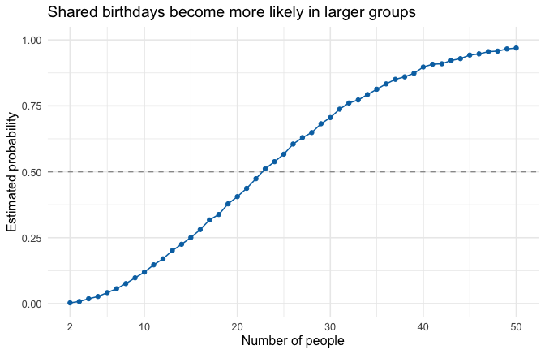
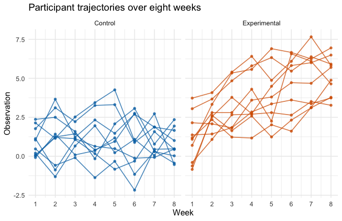
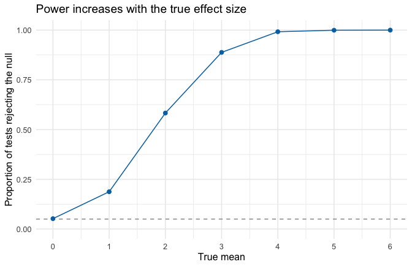
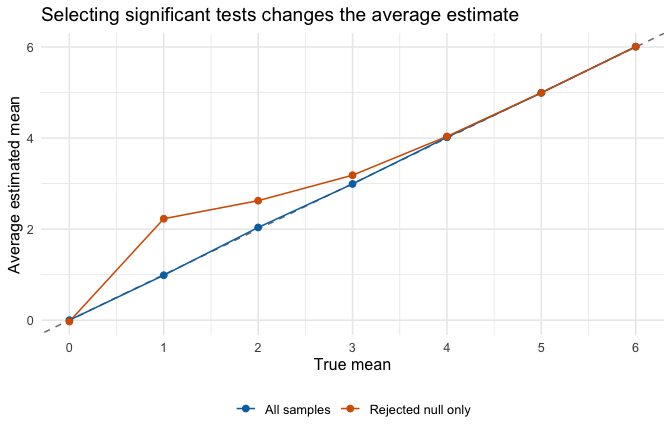

P8105 Homework 5
================

## Problem 1: Shared birthdays

I assume 365 equally likely birthdays and independent birthdays across
people. The function below samples birthdays with replacement and
returns whether at least one birthday appears more than once.

``` r
birthday_repeated = function(n_people) {
  birthdays = sample(1:365, size = n_people, replace = TRUE)
  repeated = length(unique(birthdays)) < n_people
  return(repeated)
}
```

I run 10,000 simulations for each group size from 2 through 50.
Averaging the logical results estimates the probability of at least one
shared birthday.

``` r
set.seed(2367)

birthday_results =
  expand_grid(
    n_people = 2:50,
    iteration = 1:10000
  ) |>
  mutate(shared_birthday = map_lgl(n_people, birthday_repeated))

birthday_summary =
  birthday_results |>
  group_by(n_people) |>
  summarize(probability = mean(shared_birthday), .groups = "drop")
```

``` r
birthday_summary |>
  ggplot(aes(x = n_people, y = probability)) +
  geom_hline(yintercept = 0.5, linetype = "dashed", color = "grey60") +
  geom_line(color = "#0072B2") +
  geom_point(color = "#0072B2", size = 1.5) +
  scale_x_continuous(breaks = c(2, 10, 20, 30, 40, 50)) +
  scale_y_continuous(limits = c(0, 1)) +
  labs(
    title = "Shared birthdays become more likely in larger groups",
    x = "Number of people",
    y = "Estimated probability"
  )
```

<div class="figure">


<p class="caption">

Estimated probability of at least one shared birthday, using 10,000
simulations per group size.
</p>

</div>

The estimated probability is 0.003 for two people, 0.511 for 23 people,
and 0.969 for 50 people. The probability increases rapidly as the group
grows and is around one half with only 23 people. A match can occur
between any pair of people, not only with one selected person’s
birthday; the number of possible pairs increases as the group gets
larger. Small simulation fluctuations are expected because these
probabilities are estimated from random samples.

## Problem 2: Longitudinal study

The data come from the [assignment’s ZIP
archive](https://p8105.com/data/hw5_data.zip). Each file contains one
participant’s eight weekly observations. I first create a dataframe of
relative file paths, then use `map` to read each file into a list
column. I extract the arm and subject ID from the filename and reshape
the weekly measurements into long format. Subject IDs are repeated
across arms, so I retain a unique participant identifier combining both.

``` r
study_data =
  tibble(
    file_path = list.files("data", pattern = "\\.csv$", full.names = TRUE)
  ) |>
  mutate(
    observations = map(file_path, read_csv, show_col_types = FALSE),
    file_name = basename(file_path),
    participant_id = str_remove(file_name, "\\.csv$")
  ) |>
  separate(file_name, into = c("arm", "subject_id"), sep = "_") |>
  mutate(
    subject_id = str_remove(subject_id, "\\.csv$"),
    arm = recode(arm, con = "Control", exp = "Experimental")
  ) |>
  select(-file_path) |>
  unnest(observations) |>
  pivot_longer(
    cols = starts_with("week_"),
    names_to = "week",
    names_prefix = "week_",
    values_to = "observation"
  ) |>
  mutate(week = as.integer(week)) |>
  select(participant_id, subject_id, arm, week, observation) |>
  arrange(arm, subject_id, week)
```

The tidy dataset contains 20 participants and 160 participant-week
observations, with 0 missing outcome values.

``` r
study_summary =
  study_data |>
  group_by(arm) |>
  summarize(
    participants = n_distinct(participant_id),
    week_1_mean = mean(observation[week == 1]),
    week_8_mean = mean(observation[week == 8]),
    mean_change = week_8_mean - week_1_mean,
    .groups = "drop"
  )

knitr::kable(
  study_summary,
  digits = 2,
  col.names = c("Arm", "Participants", "Week 1 mean", "Week 8 mean", "Mean change"),
  caption = "Group summaries of the longitudinal observations."
)
```

| Arm          | Participants | Week 1 mean | Week 8 mean | Mean change |
|:-------------|-------------:|------------:|------------:|------------:|
| Control      |           10 |        0.92 |        0.74 |       -0.18 |
| Experimental |           10 |        1.14 |        5.12 |        3.98 |

Group summaries of the longitudinal observations.

``` r
study_data |>
  ggplot(aes(x = week, y = observation, group = participant_id, color = arm)) +
  geom_line(alpha = 0.75, linewidth = 0.6) +
  geom_point(alpha = 0.75, size = 1.3) +
  facet_wrap(~arm) +
  scale_x_continuous(breaks = 1:8) +
  scale_color_manual(values = c("Control" = "#0072B2", "Experimental" = "#D55E00")) +
  guides(color = "none") +
  labs(
    title = "Participant trajectories over eight weeks",
    x = "Week",
    y = "Observation"
  )
```

<div class="figure">


<p class="caption">

Each line represents one participant; groups are shown on the same
vertical scale.
</p>

</div>

The experimental group generally increases over time, while the control
group fluctuates without a similarly clear upward pattern. The
experimental mean rises from 1.14 to 5.12, a change of 3.98. The
corresponding control means are 0.92 and 0.74. Individual trajectories
vary within both groups, but the groups appear more separated by the end
of follow-up. This is a descriptive comparison; the plot alone does not
establish statistical significance or causality.

## Problem 3: Power of a one-sample t-test

For each true mean from 0 through 6, I generate 5,000 independent
datasets with 30 observations from a normal distribution with standard
deviation 5. For each dataset, I conduct a two-sided one-sample t-test
of the null hypothesis that the mean equals zero. I save the estimated
mean and p-value using `broom::tidy`, then define rejection as a p-value
below 0.05.

``` r
sim_t_test = function(mu, n = 30, sigma = 5) {
  sample_data = rnorm(n, mean = mu, sd = sigma)

  test_results =
    t.test(sample_data, mu = 0, alternative = "two.sided") |>
    broom::tidy() |>
    select(estimate, p.value)

  return(test_results)
}
```

``` r
set.seed(2368)

test_results =
  expand_grid(
    true_mu = 0:6,
    iteration = 1:5000
  ) |>
  mutate(results = map(true_mu, sim_t_test)) |>
  unnest(results) |>
  mutate(rejected = p.value < 0.05)

test_summary =
  test_results |>
  group_by(true_mu) |>
  summarize(
    simulations = n(),
    rejection_rate = mean(rejected),
    mean_estimate = mean(estimate),
    mean_estimate_rejected = mean(estimate[rejected]),
    .groups = "drop"
  )

knitr::kable(
  test_summary,
  digits = 3,
  col.names = c(
    "True mean", "Simulations", "Rejection rate",
    "Mean estimate: all", "Mean estimate: rejected"
  ),
  caption = "Simulation results for two-sided one-sample t-tests."
)
```

| True mean | Simulations | Rejection rate | Mean estimate: all | Mean estimate: rejected |
|---:|---:|---:|---:|---:|
| 0 | 5000 | 0.052 | 0.001 | -0.029 |
| 1 | 5000 | 0.187 | 0.988 | 2.229 |
| 2 | 5000 | 0.583 | 2.037 | 2.625 |
| 3 | 5000 | 0.888 | 2.992 | 3.185 |
| 4 | 5000 | 0.992 | 4.017 | 4.036 |
| 5 | 5000 | 0.999 | 4.994 | 4.996 |
| 6 | 5000 | 1.000 | 6.008 | 6.008 |

Simulation results for two-sided one-sample t-tests.

``` r
test_summary |>
  ggplot(aes(x = true_mu, y = rejection_rate)) +
  geom_hline(yintercept = 0.05, linetype = "dashed", color = "grey60") +
  geom_line(color = "#0072B2") +
  geom_point(color = "#0072B2", size = 2) +
  scale_x_continuous(breaks = 0:6) +
  scale_y_continuous(limits = c(0, 1)) +
  labs(
    title = "Power increases with the true effect size",
    x = "True mean",
    y = "Proportion of tests rejecting the null"
  )
```

<div class="figure">


<p class="caption">

Rejection rates from 5,000 simulations at each true mean. At a true mean
of zero, the rate estimates Type I error rather than power against a
false null.
</p>

</div>

At a true mean of zero, the rejection rate is 0.052, close to the
nominal Type I error rate of 0.05. As the true mean moves farther from
zero with sample size and variability held fixed, the standardized
effect size increases and the test has greater power. The estimated
power is 0.583 at a true mean of 2 and 1 at a true mean of 6. Larger
effects are easier to distinguish from sampling noise.

``` r
test_summary |>
  select(true_mu, mean_estimate, mean_estimate_rejected) |>
  pivot_longer(
    cols = starts_with("mean_estimate"),
    names_to = "samples",
    values_to = "average_estimate"
  ) |>
  mutate(
    samples = recode(
      samples,
      mean_estimate = "All samples",
      mean_estimate_rejected = "Rejected null only"
    )
  ) |>
  ggplot(aes(x = true_mu, y = average_estimate, color = samples)) +
  geom_abline(intercept = 0, slope = 1, linetype = "dashed", color = "grey50") +
  geom_line() +
  geom_point(size = 2) +
  scale_x_continuous(breaks = 0:6) +
  scale_color_manual(values = c("All samples" = "#0072B2", "Rejected null only" = "#D55E00")) +
  labs(
    title = "Selecting significant tests changes the average estimate",
    x = "True mean",
    y = "Average estimated mean",
    color = NULL
  )
```

<div class="figure">


<p class="caption">

Average estimated means across all samples and across samples with
significant tests. The dashed line indicates equality with the true
mean.
</p>

</div>

Across all samples, the average estimated mean is close to the true
mean, as expected because the sample mean is unbiased. Among samples
with rejected null hypotheses, the average estimate is generally too
large for small positive true means. For example, at a true mean of 1,
the average is 0.988 across all samples but 2.229 among rejected tests.
Conditioning on significance preferentially retains samples whose
estimates are farther from zero relative to their estimated standard
errors. For positive effects with limited power, this selection mostly
favors upward deviations and exaggerates the effect size.

As power approaches one, almost every sample is retained, so the two
averages converge. At a true mean of zero, the two-sided rejection rule
is symmetric: significant positive and negative estimates cancel in
expectation. The signed conditional average is therefore zero in
expectation, although the finite simulation average may differ from
zero. This does not mean individual significant estimates under the null
are small; their absolute magnitudes are selectively large.

## References

The organization and iteration patterns follow the course examples in
[Writing
Functions](https://github.com/p8105/iteration/blob/main/01_writing_functions.Rmd),
[List
Columns](https://github.com/p8105/iteration/blob/main/02_list_columns.Rmd),
and
[Simulation](https://github.com/p8105/iteration/blob/main/03_simulation.Rmd).
The analyses address the [Homework 5
instructions](https://p8105.com/homework_5.html) and use the [course
style rubric](https://p8105.com/homework_style_rubric.html).
